# Klassendiagramm

> Beleg-Anforderung C7: „Klassendiagramm — falls eigene Klassen erstellt wurden“.
> Dargestellt: der Logikkern `QuadroControl.Core` und die Adapter der beiden
> WPF-Programme. Das Diagramm entspricht dem **tatsächlichen Code** (C# 7.3,
> netstandard2.0/net452 für den Core). Kurseigene Bibliotheken (DLLs) sind als
> externe Klassen gekennzeichnet.

## Gesamtbild: Core + beide Programme

```mermaid
classDiagram
    direction LR

    %% ---------- QuadroControl.Core: Protokoll ----------
    class UavTalkBuilder {
        <<statisch>>
        +SyncByte : byte = 0x3C
        +HeaderLength : int = 10
        +Build(messageType, objectId, instanceId, data) byte[]
        +BuildHex(messageType, objectId, instanceId, data) string
    }
    class Hex {
        <<statisch>>
        +ToHexString(bytes) string
        +Parse(hexString) byte[]
        +SameBytes(hexA, hexB) bool
    }
    class FloatHex {
        <<statisch>>
        +ToHexString(value) string
        +ToBytes(value) byte[]
        +FromBytes(bytes) float
        +Int16ToBytes(value) byte[]
    }
    class ObjectIds {
        <<statisch>>
        +ManualControlCommand : byte[]  "C4 10 74 80"
        +AccessoryDesired : byte[]  "C4 09 98 5A"
        +GcsTelemetryStats : byte[]  "CA D1 DC 0A"
    }
    class UavTalkMessageType {
        <<enum>>
        ObjectData = 0x20
        ObjectRequest = 0x21
        ObjectAcknowledged = 0x22
        Ack = 0x23
        Nak = 0x24
    }
    class ManualControlCommandData {
        +Throttle : float
        +Roll : float
        +Pitch : float
        +Yaw : float
        +Collective : float
        +Thrust : float
        +Connected : byte
        +FlightModeSwitchPosition : byte
        +PayloadLength : int = 46
        +Neutral()$ ManualControlCommandData
        +ForArming()$ ManualControlCommandData
        +ToPayload() byte[]
    }
    class AccessoryDesiredData {
        <<statisch>>
        +ArmingValue : float = 1
        +DisarmingValue : float = -1
        +ToPayload(accessoryVal) byte[]
    }
    class GcsTelemetryStatsData {
        <<statisch>>
        +CounterBytes : int = 36
        +PayloadLength : int = 37
        +ToPayload(status) byte[]
    }
    class GcsTelemetryStatus {
        <<enum>>
        Disconnected = 0
        HandshakeReq = 1
        HandshakeAck = 2
        Connected = 3
    }

    %% ---------- QuadroControl.Core: Kommunikation ----------
    class MessageFactory {
        <<statisch>>
        +BuildManualControlCommand(command) string
        +BuildAccessoryDesired(accessoryVal) string
        +BuildGcsTelemetryStats(status) string
        +BuildHeartbeat() string
    }
    class HandshakeSequenceProvider {
        <<statisch>>
        +MessageCount : int = 5
        +GetMessages()$ string[]
    }
    class HandshakeMetadata {
        <<statisch>>
        +ManualControlCommandMetadata : string  "VL5 Folie 39, wortwörtlich"
        +AccessoryDesiredMetadata : string  "VL5 Folie 39, wortwörtlich"
    }
    class HeartbeatMessage {
        <<statisch>>
        +IntervalMs : int = 1000
        +Create()$ string
    }
    class CommState {
        <<enum>>
        Disconnected
        PortOpen
        Handshaking
        HeartbeatActive
        Armed
    }
    class CommStateMachine {
        +State : CommState
        +CanSendControlCommands : bool
        +IsArmed : bool
        +StateChanged : event
        +OpenPort() void
        +StartHandshake() void
        +CompleteHandshake() void
        +Arm() void
        +Disarm() void
        +Close() void
    }
    class IQuadroTransport {
        <<interface>>
        +Verbinde(comPort) bool
        +VerbindungTrennen() bool
        +SchickeHexString(hexString) void
    }

    %% ---------- QuadroControl.Core: Controller + Sicherheit ----------
    class ControllerMapping {
        <<statisch>>
        +AxisMax : short = 32767
        +AxisMin : short = -32768
        +ThrottleFromAxis(leftStickY)$ float
        +YawFromAxis(leftStickX)$ float
        +RollFromAxis(rightStickX)$ float
        +PitchFromAxis(rightStickY)$ float
        +ToManualControlCommand(...) ManualControlCommandData
    }
    class SafetyMonitor {
        +Evaluate(controllerConnected, isArmed, anyInputActive) SafetyDecision
        +NeutralCommand()$ ManualControlCommandData
    }
    class SafetyDecision {
        +ShallDisarm : bool
        +ShallSendNeutralCommand : bool
        +ControllerLost : bool
    }
    class QuadroConfig {
        <<statisch>>
        +HeartbeatIntervalMs : int = 1000
        +ArmingRepeatCount : int = 5
        +ArmingRepeatDelayMs : int = 50
        +ControllerPollIntervalMs : int = 20
    }

    %% ---------- Programme ----------
    class MainWindowVirtuell {
        <<WPF Window — QuadroControl.Virtuell>>
        -_commState : CommStateMachine
        -_transport : VirtuellQuadroTransport
        -_safety : SafetyMonitor
        -ControllerThread : Thread
        -HeartbeatThread : Thread
        -XBox : Controller
        +vSchickeHexString(hexString)$ void  "NICHT ÄNDERN (Vorlage)"
        -BT_COMPortVerbinde_Click(...) void
        -BT_COMPortTrennen_Click(...) void
        -BT_HS_HB_Click(...) void
        -BT_XBoxRead_Click(...) void
        -ControllerThreadFunction() void
        -HeartbeatThreadFunction() void
        -ArmingSequenz() void
        -DisarmingSequenz() void
        -VerbindungSauberTrennen() void
        -UpdateGUI(values) void  "via Dispatcher"
    }
    class MainWindowReal {
        <<WPF Window — QuadroControl.Real>>
        -_commState : CommStateMachine
        -_transport : RealQuadroTransport
        -_safety : SafetyMonitor
        -ControllerThread : Thread
        -HeartbeatThread : Thread
        -XBox : Controller
        -BT_COMPortsAktualisieren_Click(...) void
        -BT_COMPortVerbinde_Click(...) void
        -BT_COMPortTrennen_Click(...) void
        -BT_HS_HB_Click(...) void
        -BT_XBoxRead_Click(...) void
        -ControllerThreadFunction() void
        -HeartbeatThreadFunction() void
        -ArmingSequenz() void
        -DisarmingSequenz() void
        -VerbindungSauberTrennen() void
        -UpdateGUI(values) void  "via Dispatcher"
    }
    class VirtuellQuadroTransport {
        +Verbinde(comPort) bool
        +VerbindungTrennen() bool
        +SchickeHexString(hexString) void
        -_vmyQC : vQuadroControl
        -_sende : Action~string~
    }
    class RealQuadroTransport {
        +Verbinde(comPort) bool
        +VerbindungTrennen() bool
        +SchickeHexString(hexString) void
        +HoleAktuelleCOMPorts() string[]
        +KonvertiereFloatZuHexString(wert) string
        -_myQC : QuadroControl  "KTCQuadroControl"
    }
    class vQuadroControl {
        <<extern — vKTCQuadroControl.dll>>
        +vVerbinde(comPort) bool
        +vVerbindungTrennen() bool
        +v_SchickeHexString(hexString) void
    }
    class KTCQuadroControl {
        <<extern — KTCQuadroControl.dll>>
        +Verbinde(comPort) bool
        +VerbindungTrennen() bool
        +SchickeHexString(hexString)$ void
        +HoleAktuelleCOMPorts()$ string[]
        +KonvertiereFloatZuHexString(wert)$ string
    }
    class XInputController {
        <<extern — SharpDX.XInput>>
        +IsConnected : bool
        +GetState() State
    }

    %% ---------- Beziehungen ----------
    MessageFactory ..> UavTalkBuilder : baut Rahmen
    MessageFactory ..> ManualControlCommandData
    MessageFactory ..> AccessoryDesiredData
    MessageFactory ..> GcsTelemetryStatsData
    UavTalkBuilder ..> Hex : Hex-String
    UavTalkBuilder ..> UavTalkMessageType
    ManualControlCommandData ..> FloatHex : Little Endian
    AccessoryDesiredData ..> FloatHex
    GcsTelemetryStatsData ..> FloatHex
    HandshakeSequenceProvider --> MessageFactory : 3 Status-Nachrichten
    HandshakeSequenceProvider --> HandshakeMetadata : 2 Metadaten wortwörtlich
    HeartbeatMessage --> MessageFactory
    CommStateMachine --> CommState
    SafetyMonitor --> SafetyDecision
    SafetyMonitor ..> ManualControlCommandData : NeutralCommand
    ControllerMapping ..> ManualControlCommandData
    ControllerMapping ..> QuadroConfig

    MainWindowVirtuell --> CommStateMachine
    MainWindowVirtuell --> SafetyMonitor
    MainWindowVirtuell --> ControllerMapping
    MainWindowVirtuell --> HandshakeSequenceProvider : Handshake
    MainWindowVirtuell --> HeartbeatMessage : Heartbeat
    MainWindowVirtuell --> MessageFactory : Steuerbefehle
    MainWindowVirtuell --> QuadroConfig
    MainWindowVirtuell --> XInputController
    MainWindowVirtuell --> VirtuellQuadroTransport : IQuadroTransport
    VirtuellQuadroTransport ..|> IQuadroTransport
    VirtuellQuadroTransport --> vQuadroControl : kapselt

    MainWindowReal --> CommStateMachine
    MainWindowReal --> SafetyMonitor
    MainWindowReal --> ControllerMapping
    MainWindowReal --> HandshakeSequenceProvider : Handshake
    MainWindowReal --> HeartbeatMessage : Heartbeat
    MainWindowReal --> MessageFactory : Steuerbefehle
    MainWindowReal --> QuadroConfig
    MainWindowReal --> XInputController
    MainWindowReal --> RealQuadroTransport : IQuadroTransport
    RealQuadroTransport ..|> IQuadroTransport
    RealQuadroTransport --> KTCQuadroControl : kapselt
```

## Lesung des Diagramms

- **Trennung Kern / Adapter:** `QuadroControl.Core` kennt weder die Kurs-DLLs
  noch WPF — dadurch ist der Protokollkern unter Linux bauen- und testbar
  (79 Unit-Tests). Die DLL-Aufrufe stecken ausschließlich in den beiden
  Transport-Adaptern (`VirtuellQuadroTransport`, `RealQuadroTransport`), die
  beide das schmale Interface `IQuadroTransport` erfüllen.
- **Eine Logik, zwei Programme:** Beide `MainWindow`-Klassen nutzen denselben
  Core; sie unterscheiden sich nur im Adapter (und damit in der DLL: 
  `vKTCQuadroControl` für die virtuelle Testumgebung, `KTCQuadroControl` für
  den realen FC) sowie in zwei Real-Extras: `HoleAktuelleCOMPorts()` und
  `KonvertiereFloatZuHexString()`.
- **Sicherheitskette:** `MainWindow` (Threads) fragt je Zyklus `SafetyMonitor`
  → Entscheidung (`SafetyDecision`) → Aktion gegen `CommStateMachine`, die
  unzulässige Übergänge mit Ausnahme blockiert. Das Arming läuft als Sequenz
  über `MessageFactory`/`HandshakeMetadata`-freie Standardnachrichten
  (`ManualControlCommandData.ForArming()` + `AccessoryDesiredData.ArmingValue`).
- **Statik:** Klassen mit `<<statisch>>` sind C#-`static`-Klassen (nur
  Klassenmember, keine Instanz), `<<enum>>` sind Aufzählungen, `<<extern>>`
  sind vom Kurs gelieferte bzw. NuGet-Bibliotheken (Quelle: `Vorlage_VS.zip`,
  `SharpDX.XInput` 4.2.0).
