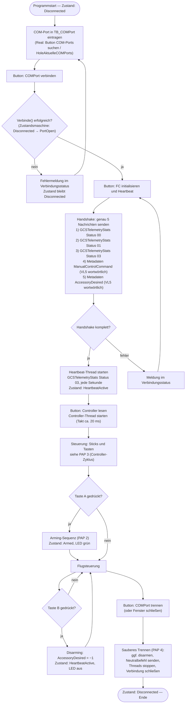
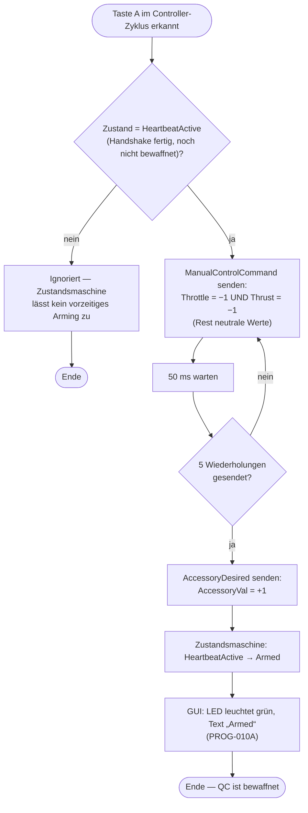
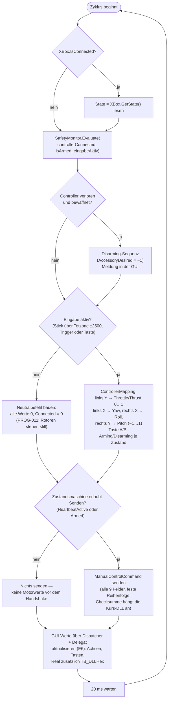
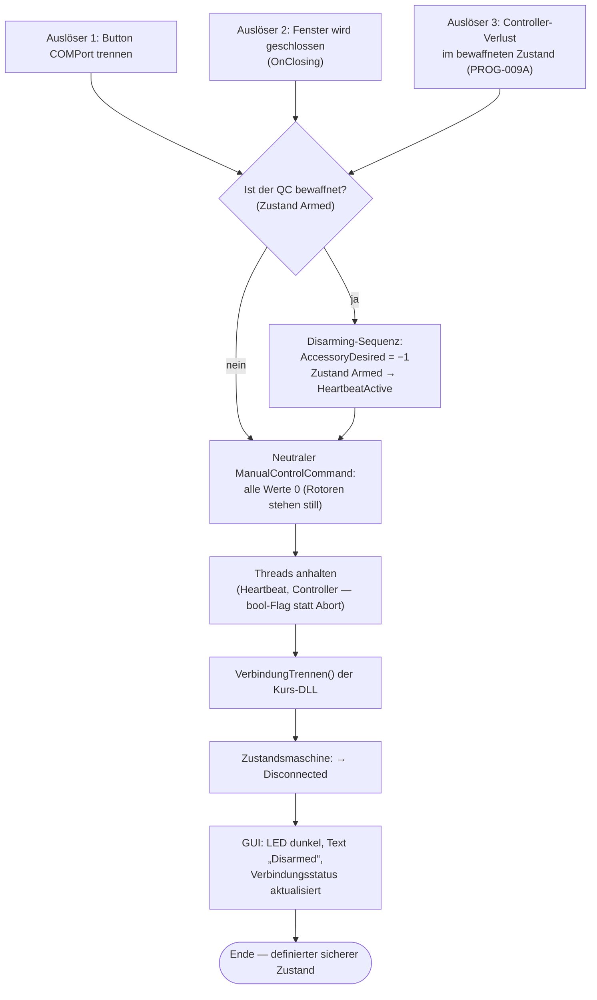

# Programmablaufpläne (PAP)

> Beleg-Anforderung C6: „Programmablaufpläne zur Darstellung der Programmlogik“.
> Die Pläne beschreiben den **tatsächlich implementierten** Ablauf beider
> Programme (`MainWindow.xaml.cs` von Virtuell und Real; der Logikkern liegt in
> `QuadroControl.Core`). Darstellung als Mermaid-Diagramme (in GitHub/VS Code
> direkt gerendert).

## 1. Verbindungs- und Kommunikationsablauf (Gesamtablauf)

Entspricht den 5 Schritten der VL5: verbinden → Handshake → Heartbeat →
steuern/armen → trennen.

## 2. Arming-Sequenz (Taste A, E5)

## 3. Controller-Thread — ein Zyklus (ca. 20 ms, VL6-Muster)

## 4. Sicherheitsreaktionen (Trennen / Controller-Verlust)

## Hinweise zu den Plänen

- Die **Checksumme (CRC-8)** erscheint in keinem PAP als eigener Schritt, weil
  die App sie niemals berechnet — `SchickeHexString()` der Kurs-DLL hängt sie
  automatisch an (Vertragsregel, wissen §5 Feld G).
- Die Zustandsmaschine (`Disconnected → PortOpen → Handshaking →
  HeartbeatActive → Armed`) ist die strukturelle Sicherheitssperre: Jeder
  unzulässige Übergang wirft eine Ausnahme, statt still Steuerwerte zu senden.
- GUI-Zugriffe aus den Nebenthreads laufen ausschließlich über
  `Dispatcher.CheckAccess()` + `BeginInvoke` mit dem Delegaten `UpdateGUI`
  (WPF-Regel E6 aus VL6).
